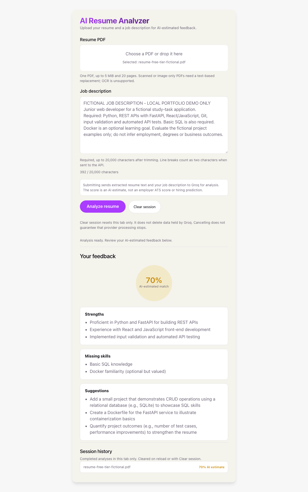
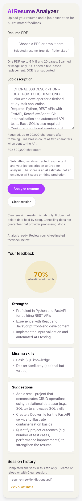
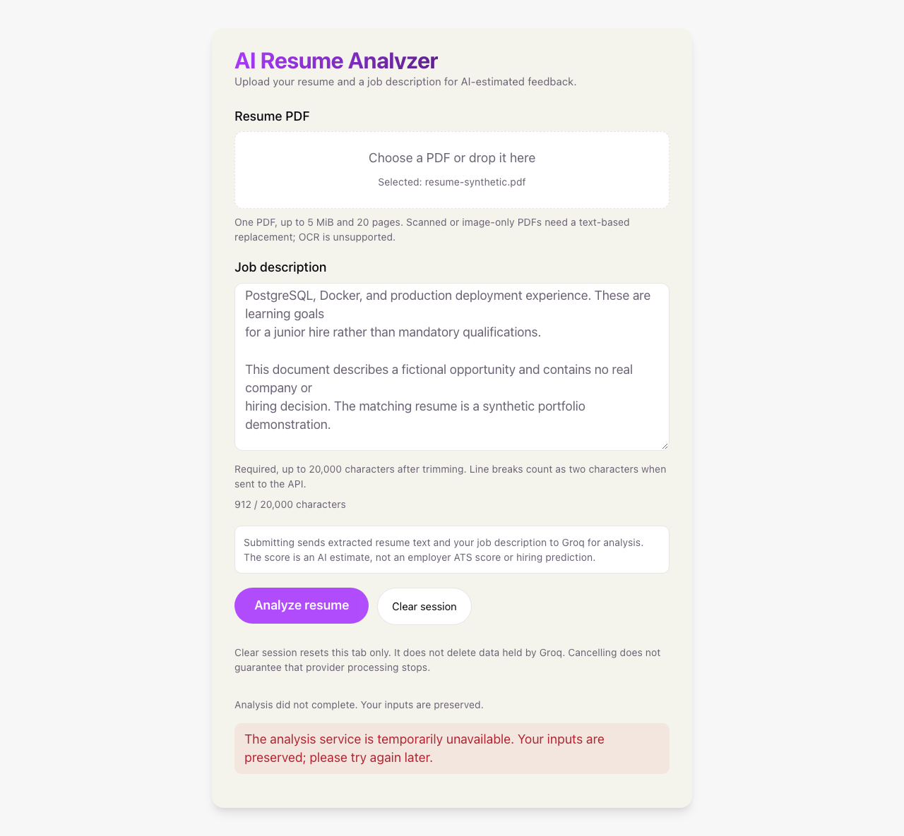
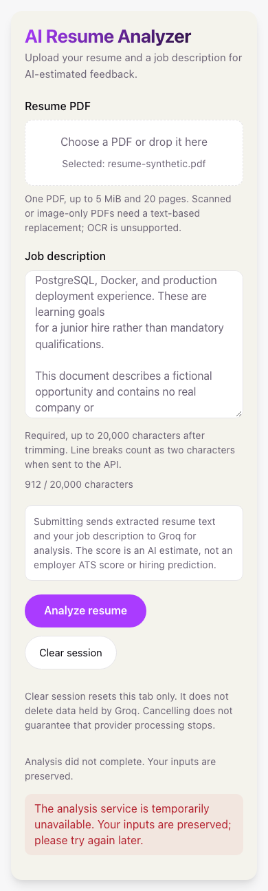

# AI Resume Analyzer

Upload a text-based PDF resume and paste a job description to receive an AI
estimate of fit, strengths, missing skills, and suggestions. The React/Vite UI
calls a FastAPI backend, which extracts PDF text with PyMuPDF and requests feedback
from Groq using configurable `GROQ_MODEL`, defaulting to `openai/gpt-oss-120b`.
This is a Groq-hosted model identifier; the application does not use OpenAI's API.

The match score is an AI estimate, not a validated employer ATS score or a
prediction of hiring outcomes. There is no independently validated scoring rubric.

**Free-only, local use:** this project must not incur charges. Use only Groq
Free-tier access; do not upgrade plans, add payment methods, enable paid services,
use a paid fallback, or provision hosting. Tests use mocks. No additional live
provider request is currently authorized; the cumulative live-analysis count is two.

Before any future authorized live request, confirm the organization and project
associated with your configured key in the Groq Console. In
[Settings → Billing → Plans](https://console.groq.com/settings/billing/plans),
verify the **current plan** is **Free ($0)**, rather than merely seeing a Free
plan offered. In [Organization Limits](https://console.groq.com/settings/limits)
and the selected project's **Settings → Project → Limits**, verify
`openai/gpt-oss-120b` is available within free limits; review remaining usage in
**Usage**. Do not change billing settings or share your key. If these facts cannot
be established, payment is required, or free limits are exhausted, stop before
submitting. A key, public catalog, successful request, or `/ready` response cannot
prove your billing status. No authenticated account-console review was performed.

The user privately confirmed the key-to-console association and Free ($0) limits
for this model: **30 requests/minute, 1,000 requests/day, 8,000 tokens/minute,
200,000 tokens/day**. No key suffix or account screenshot is stored in this repo.
The backend now admits at most **4,500 estimated complete input tokens**, reserves
**2,000 completion tokens** for reasoning and JSON, and leaves **1,500 tokens of
headroom**. Oversized requests receive HTTP 413 asking users to shorten either
document; nothing is silently truncated or sent. The bundled GPT-OSS tokenizer
runs offline. See [token accounting and its limits](docs/free-tier-budget.md).
This is per-request admission, not a remaining/shared quota or billing guarantee.
For the latest authorized attempt, the user also confirmed no custom project
limits or pending GPT-OSS model terms. Reconfirm access, any separate input/output
restrictions and remaining usage before a future authorized request. The
application does not enforce or verify the account's billing plan.

**Current live-verification status:** one authorized fictional browser submission
with `openai/gpt-oss-120b` succeeded with HTTP 200, a schema-valid 70% AI estimate,
and feedback displayed at desktop and mobile sizes. It used exactly one additional
Groq request, no retries: the cumulative live-analysis count is **two**. The earlier
legacy-model request failed with provider 404/application 503. See the
[GPT-OSS live record](docs/live-verification-gptoss.md) and
[historical failure record](docs/live-verification.md). Automated tests still use
stubs; one success establishes integration, not scoring accuracy or future quota.

The [offline 404 diagnosis](docs/provider-404-diagnosis.md) found the SDK route
correct and no observed base-URL override. Groq's official notice retired this
model for free/developer use on August 16, 2026, with an enterprise committed-spend
exception. The key's tier was unknown during that diagnosis; the later user
confirmation of Free status does not establish the original error's exact cause.
The subsequent
[offline model migration](docs/model-migration.md) selects the documented
replacement without claiming that the original account-specific cause was proven.
The migration itself was offline. A later, separately authorized request verified
generation with the replacement without changing account or billing settings.

## Stack and project structure

| Component | Technology and main files |
| --- | --- |
| Interface | React 19, Vite 8, plain CSS; `frontend/src/App.jsx` and `App.css` |
| Browser validation/API handling | `frontend/src/analysis.js`; no provider credentials in the browser |
| API and configuration | FastAPI, Uvicorn, python-dotenv; `backend/main.py` and `config.py` |
| PDF extraction and limits | PyMuPDF; `backend/input_validation.py` |
| Provider and response validation | Async Groq SDK, Pydantic; `backend/provider.py` and `schemas.py` |
| Automated tests | Python unittest/httpx, Vitest/Testing Library, Playwright; `backend/tests/`, frontend `*.test.*`, and `frontend/e2e/` |
| CI and deployment | GitHub Actions, Docker Compose, Nginx; `.github/workflows/ci.yml`, `compose.yaml`, and `deploy/nginx.conf` |

Results and history are kept in browser memory only. No database is implemented;
`backend/database.py` and `backend/models.py` are unused placeholders.

## Local setup

Fresh-install verified with Python 3.14.3, pip 26.0, Node 24.21.0, and npm 11.19.0.
Select those runtimes (`.python-version`, `.nvmrc`) before running, from the root:

```sh
python3 -m venv backend/venv
backend/venv/bin/python -m pip install pip==26.0
backend/venv/bin/python -m pip install -r backend/requirements.txt
npm ci --prefix frontend
```

Create `frontend/.env` from `frontend/.env.example` only if it does not already
exist, or add `VITE_API_BASE_URL=http://localhost:8000` to the existing file.

Set `GROQ_API_KEY` in your environment or in an ignored `backend/.env` file;
`backend/.env.example` lists the variable without a credential. Keep credentials
on the backend. In separate terminals, each starting from the repository root:

```sh
cd backend
venv/bin/python -m uvicorn main:app --reload --port 8000
```

```sh
cd frontend
npm run dev
```

Open `http://localhost:5173`. The frontend appends `/analyze` to
`VITE_API_BASE_URL`, normalizing trailing slashes. Set this public URL before
building deployment assets; Vite embeds it at build time. Rebuild after changes.
Never put provider credentials in `VITE_` variables: they are exposed in the browser.
CORS defaults to `http://localhost:5173` and `http://localhost:3000`; use
`ALLOWED_ORIGINS` for deployment origins.
Interactive API documentation is at `http://localhost:8000/docs`.

The backend starts without a key, allowing validation and tests to run. A valid
analysis request without a configured key receives HTTP 503. `/health` is liveness
only and always returns `200 {"status":"alive"}` when the application is running.
`/ready` reports local configuration only: HTTP 200 when a nonempty key is present,
otherwise 503, with `configuration_ready`, `provider_verified: false`, and
`scope: "local_configuration"`. Neither endpoint creates an SDK client or makes
provider calls. Readiness does not verify credentials, quota, connectivity, or
model availability. Configuration changes require an application restart.
Submitting a valid analysis with a key makes an external provider request.
Follow the free-only confirmation requirement above before submission; merely
configuring a key does not make a request safe from charges on an unknown plan.

`GROQ_MODEL` defaults when unset. An explicit blank value fails configuration
validation; remove it or set `GROQ_MODEL=openai/gpt-oss-120b`, then restart the
backend. Existing `.env` files and credentials are not overwritten by this migration.

## Usage

1. Choose one text-based PDF using the keyboard/file picker or drag-and-drop.
   The [clearly labeled synthetic fixtures](docs/fixtures/README.md) are available
   for demonstrations without personal data.
2. Paste a matching job description and review the privacy notice. A valid
   submission sends extracted resume text and the description to Groq. Complete
   the Free-tier/model/quota confirmation above and obtain live-request authorization
   first. Synthetic inputs still use the live provider when a key is configured.
3. Submit once. A valid response displays the AI-estimated match, strengths,
   missing skills, and suggestions. Errors preserve inputs. Retry is manual only;
   an active Retry-After countdown must expire first. Do not retry a live
   verification when its authorized request budget has been used.
4. Cancel or edit inputs to abandon a pending browser request. Old responses cannot
   replace newer state. Clear session resets inputs, results, and in-memory history;
   it does not delete provider-held data or guarantee external processing stops.

## Input contract

`POST /analyze` accepts multipart fields `file` and `job_description`.

| Input | Inclusive application limit |
| --- | --- |
| Uploaded file | 5 MiB (5,242,880 bytes) |
| PDF pages | 20 |
| Extracted resume text | 50,000 characters, including extracted whitespace |
| Job description | 20,000 characters after trimming surrounding whitespace |
| Complete request input estimate | 4,500 tokens, including instructions, both schemas and 256 tokens of framing padding |

The token ceiling applies in addition to the file/page/character limits: reaching
a character limit does not guarantee admission. All SDK request fields are counted
using GPT-OSS ordinary-text BPE; private provider rendering remains an estimate.
No tokenizer network download is needed, and counting runs in a worker thread.

The filename must end in `.pdf`, case-insensitively. The backend also opens and
reads the document as a PDF; filename and MIME type alone are insufficient.
Empty, corrupt, unreadable, encrypted, and password-protected documents are
rejected. Blank and image-only PDFs require a text-based replacement because OCR
is unsupported. Job descriptions must be nonempty after trimming.

Uploads are read in chunks of at most 64 KiB, stopping after at most 5 MiB plus
one byte to detect an oversized file. Inputs exceeding the limits are rejected,
never silently truncated. Validation finishes before the provider is invoked.

**Handler-level checks do not replace server/proxy request-body limits.** The
framework parses multipart uploads before the handler and may spool them to
temporary disk. Configure a total request-body limit at the server or proxy,
allowing space for multipart overhead and the job description. The included
container path enforces a 6-MiB total-body cap at Nginx; direct Uvicorn development
startup does not provide that proxy limit.

## Analysis response

Successful responses contain exactly these four required fields:

```json
{
  "match_score": 75,
  "strengths": ["Python project experience"],
  "missing_skills": ["SQL"],
  "suggestions": ["Describe the synthetic project's outcomes"]
}
```

This is an illustrative synthetic response, not a live model result or fallback.
`match_score` must be an integer from 0 through 100. Booleans, strings, fractional
values, and floating-point values such as `75.0` are rejected. Each feedback field
must be an array containing 0–20 strings; each string must contain 1–1,000
characters after trimming. Unknown fields are rejected. FastAPI's response model,
OpenAPI schema, provider prompt, and runtime validation share this contract.

Empty, malformed, incomplete, non-JSON, or schema-invalid provider output fails
with HTTP 502. Markdown-fenced JSON is not raw JSON and is rejected. Invalid
responses never receive fallback scores.

| HTTP status | Meaning |
| --- | --- |
| 400 | Unsupported filename, empty file, corrupt/unreadable PDF, or file-read failure |
| 413 | Upload, page, resume-text, or job-description limit exceeded |
| 422 | Missing/invalid form fields, whitespace-only description, encrypted PDF, or textless PDF |
| 502 | Provider connection/server failure, other rejected upstream request, unexpected provider failure, or invalid analysis output |
| 503 | Missing/invalid provider credentials, denied provider access, unavailable configured model, or provider rate limiting |
| 504 | Total provider deadline, SDK timeout, or upstream HTTP 408 |

Errors use a fixed, sanitized `detail` string, for example:

```json
{"detail": "Analysis provider returned an invalid response. Try again later."}
```

## Data handling and provider boundary

The app does not intentionally persist resumes or extracted text. Uploaded files
are closed even when validation fails; opened PDF documents use context-managed
cleanup. Framework-managed upload spooling may use temporary disk. The selected
file and session feedback remain in browser memory until replaced or the page is
unloaded; there is no database-backed history.

Full extracted resume text and the trimmed description are sent to Groq only after
validation. External provider retention is outside this application's deletion
controls. Use synthetic inputs for demonstrations. Public errors do not include
submitted content, credentials, provider output, or traces. Parser diagnostics and
the SDK's request/exception debug logging are suppressed; do not enable body
logging in deployment infrastructure.

Requests use strict structural JSON-schema output, `include_reasoning=false`,
`reasoning_effort=low`, and `max_completion_tokens=2000` (reasoning plus final JSON).
The prompt requests concise feedback without changing the response schema.
Truncated/non-`stop` completions receive sanitized 502, even if the JSON parses.
All public-schema bounds
are still validated by Pydantic; reasoning metadata is never exposed. There is no
automatic model/output-mode fallback. See the [parameter rationale and migration
instructions](docs/model-migration.md) before selecting a compatible override.

Each application lifespan owns one lazy `AsyncGroq` client. It is constructed on
the first valid analysis with a configured key and reused for subsequent requests.
Completions are awaited, so a pending provider request does not block independent
health requests. The FastAPI lifespan closes the client at shutdown, including
after failed or cancelled requests. Cleanup is shielded from cancellation with a
separate 5-second bound; cleanup failures/timeouts produce only a safe event.

`PROVIDER_TIMEOUT_SECONDS` defaults to 30 seconds and bounds the entire provider
execution, including client construction and the completion call, after input
validation. SDK read/write timeouts use the same value. Connect/pool timeouts are
the smaller of 5 seconds and the configured value. The total deadline cancels
pending provider execution; it does not include upload parsing or PDF extraction.
These asynchronous cancellation bounds assume a responsive event loop.

The SDK normally retries certain failures twice. This application explicitly sets
`max_retries=0` and has no application retry loop: each accepted analysis makes at
most one completion attempt. There are no automatic fallback requests or scores.
The installed SDK interface was checked against Groq's official
[async, retry, timeout, and resource-management documentation](https://github.com/groq/groq-python).

Provider authentication/permission failures (401/403) become service-level 503
responses, without blaming the user's login. A recognized `model_not_found`,
`model_decommissioned`, or `model_not_available` code maps to a model-specific 503.
An unqualified provider 404 also maps to 503, but uses neutral endpoint/resource
copy and the `upstream_not_found` category; status alone cannot diagnose the model.
Other upstream rejections and provider 5xx/connection failures map to 502;
input-validation status codes remain unchanged. Provider 429 maps to a temporary
503. A valid provider `Retry-After` integer or HTTP date is normalized to integer
seconds between 0 and 3,600; invalid values are omitted. It is exposed through CORS
for browser clients. Provider and total timeouts return sanitized 504 responses.

Every analysis request emits one JSON operational event containing only its
generated request identifier, duration in milliseconds, fixed outcome category,
and HTTP status. The identifier is returned as `X-Request-ID`; caller-supplied
identifiers are ignored. No filenames, submitted text, provider bodies, credentials,
or exception strings/traces are included. This does not configure infrastructure
access/body logging; keep sensitive body logging disabled there too.

Tests override `provider.get_provider` through FastAPI dependency injection or
exercise the real SDK with an in-memory HTTP transport. No provider key or network
connection is required for the tests.

## Configuration

| Variable | Behavior |
| --- | --- |
| `GROQ_API_KEY` | Backend-only credential; absent/blank keeps liveness and validation available but analysis returns 503 |
| `GROQ_MODEL` | Backend model ID; default `openai/gpt-oss-120b` when unset. Explicit blanks are rejected. Restart/recreate the backend after changes. |
| `GROQ_BASE_URL` | Optional SDK override; SDK 1.4.0 defaults to `https://api.groq.com` and already appends the full completion route. Do not add an extra `/openai/v1` prefix; see the [diagnosis](docs/provider-404-diagnosis.md). Compose does not forward this variable. |
| `PROVIDER_TIMEOUT_SECONDS` | Finite number from 1 through 120; default 30 |
| `ALLOWED_ORIGINS` | Comma-separated exact HTTP(S) origins; defaults to the two localhost origins when unset |
| `VITE_API_BASE_URL` | Frontend-only public backend URL, set before Vite builds; localhost example in `frontend/.env.example` |
| `PUBLIC_ORIGIN` | Compose-only exact browser origin; default `http://localhost:8080`; determines the built `/api` URL and backend allowed origin |

For deployment, set `ALLOWED_ORIGINS=https://your-frontend.example` or include both
deployment and localhost origins explicitly. A configured list replaces the
defaults; an empty list denies all cross-origin access. Wildcards, credentials,
paths, and malformed origins are rejected at startup with fixed messages.
Credentialed CORS uses only that explicit list; it never allows `*`.

Start from `backend/.env.example` without overwriting an existing `.env`. No
credentials are stored in the example. Local and Compose examples select
`openai/gpt-oss-120b`. Groq lists it as a production model and recommended legacy
replacement; the [migration record](docs/model-migration.md) links the official
parameter/structured-output documentation checked against SDK 1.4.0.

## Checks

From the repository root:

```sh
backend/venv/bin/python -m unittest discover -s backend/tests -v
backend/venv/bin/python -m pip check
backend/venv/bin/python scripts/check_no_key.py
cd frontend
npm test
npm run lint
npm run build
npx playwright install chromium
npm run test:e2e
```

The 81 backend tests generate synthetic PDFs and use stubs or mocked SDK transport
with network connections blocked. They cover input boundaries, extraction,
encryption, response validation, sanitized failures/logging, configuration, CORS,
OpenAPI, request-count bounds, SDK timeout settings, client cleanup, complete-request
token boundaries, Unicode, offline tokenizer integrity and truncation. Event-based
concurrency tests hold a provider request pending while health completes and
expire real cancellation scopes deterministically without elapsed-time assertions.
The installed test client currently
emits an `httpx` deprecation warning; tests still pass.

The frontend includes 56 unit/component tests and twelve Chromium browser
checks across desktop and mobile viewports. Browser checks use a production build
and a test-only FastAPI server to exercise multipart upload and real PDF extraction
with an injected synthetic provider. They also verify safe errors, manual retry,
keyboard access, Unicode limits, token-budget rejection/recovery, duplicate/stale request handling, and session
clearing. Generated screenshots are under `frontend/test-results/screenshots/`.
See [frontend setup, behavior, and test documentation](frontend/README.md).

See [fresh-install results, CI, and advisory review](docs/verification.md) for exact
runtime versions, dependency/test installation, and local versus hosted evidence.
GitHub Actions runs the automated checks without provider credentials.

## Screenshots

These **live success screenshots** show fictional documents and real, validated
Groq feedback. Both capture the same result by resizing without another submission:




See the [live record and feedback caveats](docs/live-verification-gptoss.md).
The following historical **live-attempt error screenshots** were captured from
the same page at desktop and mobile widths without another submission. They do
not show successful live feedback. The complete fixture and verification details
are in the [live record](docs/live-verification.md).




Previously generated screenshots under `frontend/test-results/screenshots/` come
from stub-backed tests, are ignored generated artifacts, and are not evidence of
successful live Groq analysis.

## Container deployment

See [the container deployment guide](docs/deployment.md). For a credential-free
local smoke test with Docker running:

```sh
python3 scripts/check_deployment_config.py
GROQ_API_KEY= docker compose --env-file deploy/.env.example up --build --detach --wait --wait-timeout 180
backend/venv/bin/python scripts/smoke_deployment.py
GROQ_API_KEY= docker compose --env-file deploy/.env.example down --volumes
```

Open `http://localhost:8080` while running. The built frontend and `/api` share that
origin; FastAPI is unpublished. The provider key is runtime backend configuration
only. Production images exclude test providers/routes and environment files.
The local Docker daemon was unavailable, so container builds and proxy smoke tests
remain unexecuted locally; the CI container job is the runtime verification path.

Keep this project local; do not provision hosting. The deployment guide documents
the existing container path, not authorization to publish it. Any future public
deployment would require HTTPS termination plus appropriate access and usage
controls; CORS is not authentication. Paid hosting and billable provider use are
prohibited under the current project policy.

The prior
[hosted run at `7f9219d`](https://github.com/Estifanos-Wassie/ai-resume-analyzer/actions/runs/42432107906)
passed both the checks and container jobs.

## Known limitations

- The first live attempt failed with provider 404/application 503. The precise
  account-specific cause remains unconfirmed; documented tier retirement is the
  leading explanation. See the [evidence and missing information](docs/provider-404-diagnosis.md).
  The later [GPT-OSS live check](docs/live-verification-gptoss.md) verified one
  successful generation and layout/relevance review. Its “proficient” wording
  overstates evidence of skill level; suggestions to quantify outcomes require
  actual measurements. Broader quality, remaining quotas and external retention
  remain unverified. Scoring accuracy and hiring validity are not established by
  automated checks or this successful example.
- PDF support requires extractable text. OCR, password-protected PDFs, and DOCX
  are unsupported. PDF parsing is not separately timeboxed.
- There is no persistent history, account system, application authentication,
  rate/usage control, or provisioned public HTTPS ingress. These must be addressed
  before exposing a billable endpoint; CORS is not authentication.
- Four moderate development-tooling findings remain through `minimatch@10.2.6` in
  ESLint. No compatible patched 10.x release was available at review time. The
  production-only npm audit reported zero known findings, not a vulnerability-free
  application. See the [concrete advisory review](docs/verification.md#npm-advisory-review).
- Local Docker execution was unavailable; container checks passed on the cited
  hosted runner. Public deployment, other browser engines, real mobile hardware,
  and actual screen-reader speech remain unverified. The backend test client also
  emits an existing httpx deprecation warning.
